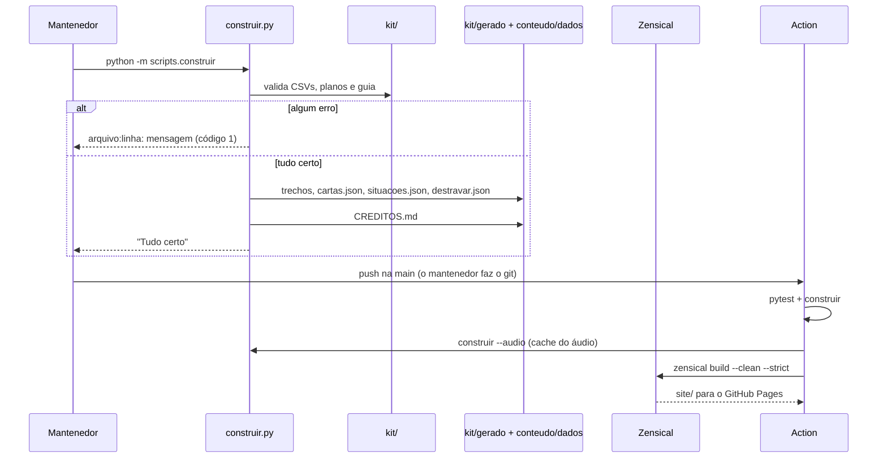
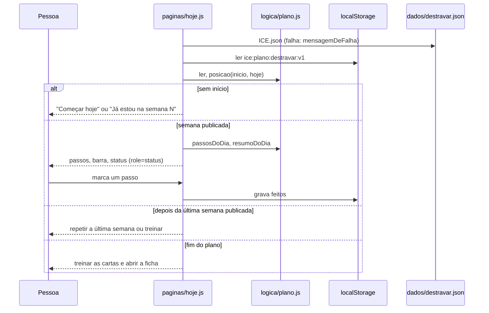

# Mapa do código

> Gerado com o Cartographer e revisado à mão. Último mapeamento: 13/11/2026, 21:05 UTC, na árvore de trabalho durante a Fase 2A, com as Tarefas 1 e 2 feitas. O que veio depois não está descrito aqui: `scripts/tatoeba.py` (confere à mão as frases do Tatoeba na API), `ancoras()` em `planos.py` e `situacoes_com_cartas()` em `construir.py` (conferência dos links do plano), o crédito do Tatoeba com o endereço da licença, e as situações 1 a 5 com as semanas 7 a 12. A autoridade do projeto é o desenho em `docs/superpowers/specs/2026-11-12-ingles-com-evidencia-design.md`; este mapa só ajuda a navegar.

## Visão geral

Guia e kit de prática de inglês, aberto e em português do Brasil.
- **Dados:** os CSVs de `kit/` são a fonte única.
- **Geração:** `python -m scripts.construir` confere os dados e gera os trechos das páginas, os JSON do site, os créditos, o áudio (voz sintética Kokoro) e os baralhos do Anki.
- **Site:** o Zensical monta o site estático a partir de `conteudo/`, com o design system Passaporte.
- **No navegador:** JavaScript sem módulos cuida do treino de cartas, da página "Hoje" e da ficha. O progresso fica só no `localStorage`.
- **Publicação:** a Action publica no GitHub Pages e, em cada tag, anexa os baralhos à Release.

```mermaid
graph TB
    subgraph Fonte["Escrito à mão"]
        CSV[kit/dados, kit/dialogos, kit/planos<br/>CSVs]
        MD[conteudo/**/*.md<br/>páginas, guia, situações]
        REG[docs/pesquisa/referencias.md<br/>registro de leitura]
        TOK[design/passaporte/tokens.json]
    end
    subgraph Scripts["scripts/ (Python 3.12)"]
        C[construir.py]
        V[validar.py + planos.py + guia.py]
        P[paginas.py]
        CR[creditos.py]
        A[audio.py<br/>Kokoro]
        B[baralhos.py<br/>genanki]
        E[estilos.py]
    end
    subgraph Gerado["Gerado"]
        G[kit/gerado/*.md]
        J[conteudo/dados/*.json]
        CRED[CREDITOS.md]
        MP3[conteudo/audio/*.mp3<br/>fora do git]
        APKG[dist/baralhos/*.apkg<br/>fora do git]
        TCSS[conteudo/estilos/tokens.css]
    end
    subgraph Site["Zensical → site/"]
        Z[zensical build --strict]
        JS[conteudo/js: nucleo, logica, paginas]
        LS[(localStorage)]
    end
    CSV --> C
    MD --> C
    REG --> C
    C --> V
    C --> P --> G & J
    C --> CR --> CRED
    C -- --audio --> A --> MP3
    C -- --baralhos --> B --> APKG
    TOK --> E --> TCSS
    G -- "--8<--" --> Z
    MD --> Z
    J --> JS
    MP3 --> JS
    JS <--> LS
    APKG -. Release da tag .-> GH[(GitHub Releases)]
    Z -. Action .-> PAGES[(GitHub Pages)]
```

## Estrutura de pastas

```
ingles-com-evidencia/
├── .github/workflows/site.yml   testes, publicação no Pages e baralhos na Release das tags
├── conteudo/                    docs_dir do Zensical: só páginas de verdade (todo .md vira página)
│   ├── index.md, sobre.md, treinar.md
│   ├── guia/                    capítulos publicados (1, 6, 8, 9, 10, 11) e a visão geral
│   ├── situacoes/               situações publicadas (6, 7, 8) e a visão geral
│   ├── trilhas/destravar/       hoje.md, index.md (semanas), ficha.md
│   ├── dados/                   cartas.json, situacoes.json, destravar.json (gerados)
│   ├── audio/                   MP3 e manifesto.json (gerados, fora do git)
│   ├── estilos/                 fontes.css, tokens.css (gerado), bundle.css, ponte.css, fontes/
│   └── js/                      nucleo.js, logica/ (pura, testada), paginas/ (DOM)
├── design/passaporte/           fonte do design system: tokens.json, README dos 8 componentes, fontes.md
├── docs/                        fora do site
│   ├── CODEBASE_MAP.md          este mapa
│   ├── pesquisa/referencias.md  registro de leitura dos estudos citados
│   └── superpowers/             specs/ (o desenho) e plans/ (um plano por fase)
├── kit/
│   ├── dados/                   situacao-NN.csv: frases dos baralhos
│   ├── dialogos/                situacao-NN.csv: falas dos diálogos
│   ├── planos/                  destravar.csv: passos de cada dia
│   └── gerado/                  frases-NN.md, dialogo-NN.md, semanas-destravar.md (gerados)
├── scripts/                     construir.py e os módulos que ele chama
├── tests/                       pytest (Python e a lógica JS via mini-racer)
├── zensical.toml                menu, CSS, JS, extensões e tema
├── pyproject.toml               só o pytest (pythonpath ".", testpaths "tests")
├── requirements-{site,kit,dev}.txt  versões fixas das dependências diretas
├── requirements-travado.txt     pip freeze inteiro, usado como restrição (-c) na Action
├── CREDITOS.md                  gerado
├── LICENSE (CC BY-SA 4.0, conteúdo), LICENSE-codigo (MIT, scripts), README.md
└── site/, dist/, .venv/         gerados ou locais, fora do git
```

## Guia dos módulos

### Build: `scripts/construir.py`

**Propósito:** a linha de comando que roda todas as etapas.
**Uso:** `python -m scripts.construir [--dados] [--dialogos] [--planos] [--conteudo] [--audio] [--baralhos]`

| Arquivo | Propósito | Tokens |
|---|---|---|
| `scripts/__init__.py` | `RAIZ`, a pasta acima de `scripts/` | 30 |
| `scripts/construir.py` | Orquestra as etapas; `validar_kit(dados, dialogos)`, `main(argv)` | 1518 |

- A raiz do projeto é `--conteudo` menos um nível. Sem flags, os dados são `<raiz>/kit/{dados,dialogos,planos}`.
- `--dados`, `--dialogos` ou `--planos` de fora da raiz: **só conferência**. Nada é gravado, e `--audio` ou `--baralhos` junto é erro.
- `--baralhos` exige `--audio`.
- Os imports de `creditos`, `audio` e `baralhos` são tardios, para o build sem áudio não exigir `kokoro_onnx`, `soundfile` nem `genanki`.

### Validação: `validar.py`, `planos.py`, `guia.py`

| Arquivo | Propósito | Tokens |
|---|---|---|
| `scripts/validar.py` | Esquemas `BARALHO` e `DIALOGO`, licenças por fonte, `Erro`, `Relatorio`, `validar_pasta`, `validar_arquivo` | 3142 |
| `scripts/planos.py` | `TRILHAS`, `RE_LINK`, `validar_plano`, `dados_do_plano`, `gravar_dados` | 1658 |
| `scripts/guia.py` | `CAPITULOS`, `SEM_CARIMBO`, `ler_registro`, `conferir_capitulo`, `conferir_guia` | 2255 |
| `scripts/situacoes.py` | `SITUACOES`: número → (slug, título), as oito | 231 |

- **CSV:** UTF-8, com vírgula. O cabeçalho com `;` ganha uma dica sobre o Excel.
- **Erros:** `arquivo:linha: mensagem`, em português. A linha 0 é o arquivo inteiro, e a 1 é o cabeçalho.
- **ids:** únicos entre baralhos e diálogos (`ids_vistos` compartilhado), porque viram o nome do áudio e o guid da nota no Anki.
- **Planos:** cada dia soma de 20 a 30 minutos, e cada passo tem de 1 a 30 minutos. O link é um caminho do site, sem `/` no início, que existe em `conteudo/`.
- **Guia:**
  - estrutura de cada capítulo (carimbo, as três seções, Armadilhas, Referências);
  - citações só nas formas permitidas;
  - toda citação com referência, e vice-versa;
  - cada referência com link `https` e entrada completa no registro.

### Geração: `paginas.py`, `creditos.py`, `estilos.py`

| Arquivo | Propósito | Tokens |
|---|---|---|
| `scripts/paginas.py` | Trechos de `kit/gerado/`, `cartas.json` e `situacoes.json`; `gerar_tudo(raiz)`, `_ler_csvs(pasta)`, `nome_audio(id)` | 1999 |
| `scripts/creditos.py` | `gerar_creditos(raiz)`: `CREDITOS.md` a partir de `fonte`, `licenca` e `autor` | 875 |
| `scripts/estilos.py` | `tokens.css` a partir de `tokens.json`, com contraste WCAG; manual (`python -m scripts.estilos`) | 1066 |

- Os botões "Ouvir" saem do gerador `disabled`, e o JavaScript os habilita pelo manifesto.
- O texto vai escapado (`_e`), e o passo do plano em Markdown passa por `_texto_md`.
- Os trechos órfãos de `kit/gerado/` são apagados.
- `_ler_csvs` é "privado", mas `audio`, `creditos` e `construir` o importam.

### Áudio e baralhos: `audio.py`, `baralhos.py`

| Arquivo | Propósito | Tokens |
|---|---|---|
| `scripts/audio.py` | `itens_de_audio`, `gerar_audios` (incremental), `baixar_modelos` (sha256, `TEMPO_LIMITE`), `sintetizador_kokoro` | 1573 |
| `scripts/baralhos.py` | `gerar_baralho(situacao, linhas, pasta_audio, destino)`: cartas "produzir", com áudio no verso | 1177 |

- **Vozes:** `af_heart` para as frases e a pessoa A, `am_michael` para a pessoa B, velocidade 0.9. O texto lido é a coluna `leitura`, se houver, senão o `en`.
- **Assinatura de cada áudio:** sha256 de `texto|voz|velocidade|modelo`. Só o que mudou é sintetizado, e os `ice-*.mp3` órfãos são apagados.
- **Modelo:** fica em `~/.cache/ingles-com-evidencia/kokoro`, ou em `$ICE_MODELOS`. O download passa por um arquivo `.parcial` e confere o sha256.
- **Fonemas:** o espeak-ng (GPL) é usado só durante a geração.
- **Anki:** nunca mudar `MODELO_ID` nem `BARALHO_BASE_ID`. O guid vem do `id` da linha, então uma correção atualiza a carta em vez de duplicá-la.

### JavaScript do site: `conteudo/js/`

| Arquivo | Propósito | Tokens |
|---|---|---|
| `conteudo/js/nucleo.js` | `ICE.url`, `ICE.armazenamento` (com `try/catch`), `ICE.json` (cache da promessa; erro `HTTP <status>`), `ICE.aoAbrirPagina`, `ICE.avisoSemArmazenamento` | 666 |
| `conteudo/js/logica/datas.js` | `ICE.datas.iso`, `somarDias` (ao meio-dia), `diasEntre` (UTC) | 352 |
| `conteudo/js/logica/audio.js` | `ICE.audio.estadoDoBotao(manifesto, arquivo)` | 135 |
| `conteudo/js/logica/treino.js` | `ICE.treino`: Leitner (1, 3, 7, 14, 30 dias), até 10 novas por dia, `fila`, `responder` | 773 |
| `conteudo/js/logica/plano.js` | `ICE.plano`: `ler`, `posicao`, `passosDoDia`, `ultimaSemana`, `depoisDoPublicado`, `proximoAberto`, `resumoDoDia`, `mensagemDeFalha` | 1232 |
| `conteudo/js/logica/ficha.js` | `ICE.ficha`: `ler`, `registrar`, `tempo`, `formatarTempo` | 806 |
| `conteudo/js/paginas/audio.js` | Liga `[data-audio]` e `[data-audio-sequencia]`; `ICE.tocar` | 527 |
| `conteudo/js/paginas/roteiro.js` | "Copiar roteiro" do `.pp-roteiro` | 286 |
| `conteudo/js/paginas/treino.js` | `#ice-treino`: filtro `?situacao=N`, cartas, foco depois de "Acertei" e "Errei" | 1679 |
| `conteudo/js/paginas/hoje.js` | `#ice-hoje`: começo do plano, passos, status, foco, depois da última semana, fim do plano | 2791 |
| `conteudo/js/paginas/ficha.js` | `#ice-ficha`: registro semanal e tabela | 1998 |

- Tudo é ES5, em IIFE sobre `globalThis.ICE`, sem módulos e sem bundler.
- A ordem de carregamento está em `zensical.toml`: `nucleo`, depois `logica/*`, depois `paginas/*`.
- A troca de página é instantânea (`navigation.instant`), então os scripts rodam uma vez só, e cada página se registra com `ICE.aoAbrirPagina`.
- A interface é montada com `textContent`, nunca com `innerHTML`.
- Chaves do `localStorage`: `ice:teste`, `ice:treino:v1`, `ice:plano:<trilha>:v1`, `ice:ficha:<trilha>:v1`. Todo estado tem `versao: 1`, e todo `ler` devolve o estado vazio quando o que está guardado não serve.

### Estilos: `conteudo/estilos/`

| Arquivo | Propósito | Tokens |
|---|---|---|
| `conteudo/estilos/fontes.css` | `@font-face` de Archivo, Figtree e IBM Plex Mono, servidas pelo próprio site | 276 |
| `conteudo/estilos/tokens.css` | Gerado por `scripts/estilos.py`; não editar | — |
| `conteudo/estilos/bundle.css` | Componentes `pp-*` do Passaporte | — |
| `conteudo/estilos/ponte.css` | Tokens do Passaporte nas variáveis `--md-*` do tema; 17 px; 48 px; componentes do JS (`ice-*`) | 2490 |

- A ordem de carregamento é fontes, tokens, bundle e ponte.
- Os seletores da ponte precisam vencer a especificidade do tema, como `[dir] .md-typeset …` e `[data-md-color-scheme] …`.

### Testes: `tests/`

| Arquivo | Propósito | Tokens |
|---|---|---|
| `tests/conftest.py` | Fixa `TZ=America/Sao_Paulo` antes do mini-racer (a Action roda em UTC) | 98 |
| `tests/js.py` | `contexto(*arquivos)`, `chamar(ctx, "ICE.x.f", *args)` (argumentos por JSON), `avaliar(ctx, expr)` | 235 |
| `tests/test_site.py` | Roda `zensical build --clean --strict` uma vez por sessão e inspeciona `site/` | 3496 |
| `tests/test_guia.py` | `guia.py` com capítulos em `tmp_path`, e conferências do guia real | 4136 |

- **Grupos:**
  - `test_js_*` cobre a lógica pura; os scripts de `paginas/` só têm a sintaxe conferida;
  - `test_validar`, `test_planos`, `test_paginas`, `test_audio`, `test_baralhos`, `test_creditos` e `test_construir` cobrem os scripts;
  - `test_estilos` e `test_fontes` cobrem o CSS e as fontes;
  - `test_publicacao` e `test_repositorio` cobrem a Action, as licenças e a privacidade.
- **Testes "em dia":** os gerados (`kit/gerado/`, `conteudo/dados/`, `CREDITOS.md`, `tokens.css`) são versionados e comparados com uma geração nova. Depois de mexer num CSV, rode o `construir`.
- **Privacidade:** `test_repositorio_sem_dados_pessoais` varre todo arquivo de texto (menos `.venv`, `site` e `.git`) atrás de dados pessoais e caminhos absolutos.

### Publicação: `.github/workflows/site.yml`

| Job | Quando | O que faz |
|---|---|---|
| `verificar` | Push, tag e pull request | `pip install -r requirements-dev.txt -c requirements-travado.txt`, `pytest -q` e `construir` (sem áudio) |
| `publicar` | Push na `main` | Caches do modelo Kokoro (chave com os dois sha256) e de `conteudo/audio`; `construir --audio`; `zensical build --clean --strict`; deploy no Pages |
| `baralhos` | Tag `v*` | Os mesmos caches; `construir --audio --baralhos`; `gh release upload --clobber` se a Release existe, senão `gh release create` |

- Sem `repo_url` no `zensical.toml`, de propósito: o tema buscaria a API do GitHub pelo navegador de quem visita.

## Fluxos

### Build e publicação



### Página "Hoje" no navegador



## O modelo de dados

| CSV | Colunas | Observações |
|---|---|---|
| `kit/dados/situacao-NN.csv` | `id`, `en`, `pt`, `situacao` ou `faixa`, `fonte`, `licenca`; opcionais `silaba`, `autor`, `leitura` | `silaba` como `va·CA·tion`, com a sílaba forte em maiúsculas |
| `kit/dialogos/situacao-NN.csv` | `id`, `situacao`, `ordem`, `falante` (A ou B), `en`, `pt`, `fonte`, `licenca`; opcionais `autor`, `leitura` | ids como `telefonar-d01` |
| `kit/planos/destravar.csv` | `semana`, `dia`, `ordem`, `passo`, `minutos`, `link` | Link no formato da URL (`situacoes/telefonar/#dialogo`, `treinar/?situacao=6`) |

- **`fonte`:** `projeto`, `ngsl` ou `tatoeba:<n>`.
  - `projeto` e `ngsl` aceitam só `CC BY-SA 4.0`.
  - `tatoeba` aceita `CC BY 2.0 FR` (com `autor`) ou `CC0`.
  - Material NC nunca entra.
- **`leitura`:** muda só o áudio. A tela e a carta mostram o `en`.
- **Cada linha de baralho vira:**
  - um `li.pp-frase` no trecho;
  - uma carta em `cartas.json`;
  - um `ice-<id>.mp3`;
  - uma nota no `.apkg`.

## Convenções

- **Idioma:** tudo em português do Brasil, inclusive comentários, mensagens de erro e nomes de função (`conferir_capitulo`, `proximoAberto`). Toda frase em inglês leva `lang="en"` e tradução.
- **Celular primeiro:**
  - texto com 17 px ou mais (a tradução e a sílaba são menores, por decisão do mantenedor);
  - toque com 48 px ou mais;
  - uma coluna até 768 px;
  - nenhuma rolagem lateral;
  - contraste AA nos dois temas.
- **Privacidade:** sem rastreadores, sem fontes de terceiros, sem dados pessoais no repositório, e nenhum caminho começando com `/` no site.
- **Comentários:** citam a decisão ou o achado de revisão que motivou o código ("M4 da 1A").
- **Componentes do Passaporte:**
  - `pp-faixa`, `pp-carimbo` (`data-nivel` de 0 a 3), `pp-secao`;
  - `pp-frases` e `pp-frase` (`__en`, `__pt`, `__silaba`, `__falante`);
  - `pp-botao` (`--primario`, `--largo`), `pp-roteiro`, `pp-progresso`;
  - `pp-passos` (`__texto`, `__tempo`, `__abrir`), `pp-tabela`.
- **Capítulo do guia:**
  - Faixa, título e Carimbo;
  - as três `<section class="pp-secao" markdown>`: "O que os cursos dizem", "O que a pesquisa diz" e "Como praticar";
  - `## Armadilhas`;
  - `## Referências`, a última seção.
- **Página de situação:**
  - Faixa, título e introdução;
  - `## Frases` e `## Diálogo` (trechos `--8<--`);
  - `## Treinar`;
  - `## Treinar com IA no modo de voz` (`pp-roteiro`);
  - `## Notas culturais`.
- **Git:** o mantenedor faz commit, push, tags e deploy. Nada é commitado automaticamente.

## Pegadinhas

- **Nenhum `.md` em `conteudo/` que não seja página.** O Zensical publica todos. Por isso o Passaporte fica em `design/` e os documentos ficam em `docs/`.
- **Link em HTML cru aponta para o `.md` de origem** (`../treinar.md?situacao=6`). O Zensical reescreve esses links a partir do arquivo de origem, e o build estrito confere. Os links do CSV do plano, ao contrário, usam o formato da URL.
- **Âncoras saem do título, sem acento e em minúsculas** ("Diálogo" vira `#dialogo`). Trocar um título quebra os links do plano que apontam para ele.
- **Trecho `--8<--` ausente derruba o build** (`check_paths = true`).
- **Arquivos gerados não se editam à mão:** `kit/gerado/`, `conteudo/dados/`, `CREDITOS.md` e `tokens.css`. Os testes "em dia" acusam a diferença.
- **Capítulo novo precisa entrar em `CAPITULOS`** (`scripts/guia.py`), senão o build acusa. Capítulo listado sem arquivo também dá erro.
- **O menu (`nav`) do `zensical.toml` é escrito à mão:** página nova não aparece sozinha.
- **O job `verificar` não gera áudio:** o `test_site.py` roda sem os MP3, e os botões "Ouvir" ficam desabilitados ali.
- **`requirements-travado.txt` precisa acompanhar os `requirements-*.txt`:** `test_requisitos_dentro_das_restricoes` acusa versão diferente.
- **Datas no JavaScript:**
  - `somarDias` usa o meio-dia e `diasEntre` usa UTC, para escapar do horário de verão;
  - um relógio que voltou conta como o primeiro dia do plano;
  - os testes fixam o fuso do Brasil.
- **A busca do Zensical 0.1.1** mostra o contador de resultados em inglês. É uma pendência conhecida.

## Guia de navegação

**Acrescentar uma situação:**
1. `kit/dados/situacao-NN.csv` e `kit/dialogos/situacao-NN.csv`, com ids novos e únicos.
2. `conteudo/situacoes/<slug>.md`, com o slug de `scripts/situacoes.py` e a estrutura acima.
3. O menu em `zensical.toml` e o item em `conteudo/situacoes/index.md`.
4. Imigração e polícia têm regras próprias no desenho (seção 5.2): fonte oficial com link e o aviso de que não é orientação jurídica.
5. Rodar `python -m scripts.construir --audio`, depois a suíte.

**Acrescentar uma semana ou um passo do plano:**
1. `kit/planos/destravar.csv`, com cada dia entre 20 e 30 minutos.
2. Rodar `python -m scripts.construir`, que regenera `semanas-destravar.md` e `destravar.json`.
3. Atualizar `tests/test_planos.py` com as regras da semana.

**Acrescentar um capítulo do guia:**
1. `conteudo/guia/<slug>.md`.
2. `CAPITULOS` em `scripts/guia.py`.
3. O menu em `zensical.toml` e o link em `conteudo/guia/index.md`.
4. Uma entrada por estudo em `docs/pesquisa/referencias.md`, só depois de ler o resumo.

**Acrescentar uma referência:**
1. `## Sobrenome et al. (AAAA)` no registro, com Link, Lido em, "O que o resumo diz" e "Usado em".
2. A mesma citação no texto do capítulo.
3. A referência completa, com `<https://…>`, em `## Referências`.

**Mudar cores, tipografia ou medidas:**
1. `design/passaporte/tokens.json`.
2. Rodar `python -m scripts.estilos`.
3. Ajustar `bundle.css` e `ponte.css` à mão.
4. Atualizar o README do componente.

**Mexer na página "Hoje", no treino ou na ficha:**
1. A lógica vai em `conteudo/js/logica/*.js`, com teste em `tests/test_js_*.py`.
2. O DOM vai em `conteudo/js/paginas/*.js`, conferido no navegador.
3. O CSS vai em `ponte.css`.

**Mudar a publicação:** `.github/workflows/site.yml`, com os testes de `tests/test_publicacao.py` e `tests/test_repositorio.py`.

## Comandos

```bash
.venv/bin/python -m pytest -q                        # suíte inteira (inclui o build do site)
.venv/bin/python -m scripts.construir                # conferir e gerar trechos, JSON e créditos
.venv/bin/python -m scripts.construir --audio        # também o áudio (baixa o modelo na primeira vez)
.venv/bin/python -m scripts.construir --audio --baralhos   # também os .apkg em dist/baralhos
.venv/bin/zensical build --clean --strict            # build estrito do site em site/
.venv/bin/zensical serve                             # site local
.venv/bin/python -m scripts.estilos                  # tokens.css depois de mudar tokens.json
```
